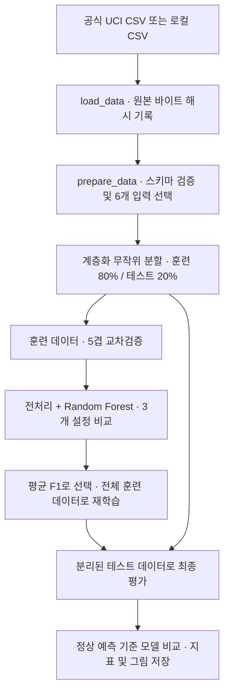
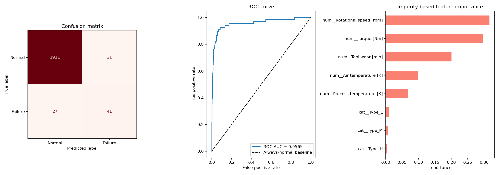

<div align="center">

# AI4I Equipment Failure Classification

### Random Forest · Imbalanced Classification · Leakage-aware Evaluation

**공개 합성 설비 데이터로 현재 고장 여부를 분류하는 개인 머신러닝 프로젝트입니다. 정답 누설을 방지한 전처리와 교차검증을 구성하고, 희소한 고장 클래스의 탐지 성능을 기준 모델과 비교합니다.**

<br/>


[](https://github.com/features/actions)

[](https://github.com/tangerineYR/predictive-maintenance-ai4i/actions/workflows/ci.yml)

**[실험 결과](results/metrics.json)** · **[평가 그림](results/evaluation.png)** · **[실행 안내](#-reproduction)**

</div>

---

## 📌 Overview

본 프로젝트는 **3학년 2학기 사물기계학습 전공 수업에서 수행한 개인 프로젝트**입니다.

UCI AI4I 2020 데이터를 활용해 각 관측의 현재 고장 여부를 분류합니다. 온도·회전 속도·토크·공구 마모 시간·제품 유형을 입력으로 사용하며, 전체 관측 중 고장은 **3.39%** 입니다.

개인 과제의 핵심 구현은 고장 유형 변수 제외, 전처리 파이프라인 구성, Random Forest 학습 및 F1 기반 모델 선택입니다. 현재 공개본은 데이터 검증, 정상 예측 기준 모델 비교, 결과 저장 및 오프라인 테스트까지 포함합니다.

### Project Info

| 항목 | 내용 |
| --- | --- |
| **프로젝트 유형** | 사물기계학습 전공 프로젝트 · 개인 |
| **수행 시기** | 3학년 2학기 |
| **데이터셋** | UCI AI4I 2020 · 공개 합성 설비 데이터 |
| **데이터 규모** | 10,000건 · 고장 339건 |
| **입력·예측 대상** | 수치형 5개·범주형 1개 → 현재 고장 여부 |
| **모델 선택** | 3개 설정 · 계층화 5겹 교차검증 · 평균 F1 |
| **최종 평가** | 별도로 분리한 테스트 데이터 2,000건 |
| **검증** | 로컬 자동화 테스트 5개 통과 |

실시간 센서 연동이나 미래 고장 시점·잔여 수명 예측은 구현 범위에 포함되지 않습니다.

---

## 📊 Key Results

[저장된 실험 결과](results/metrics.json) 기준으로 테스트 고장 **68건 중 41건을 분류**했습니다. 미탐은 27건, 정상 데이터를 고장으로 분류한 오탐은 21건입니다.

| 지표 | Random Forest | 항상 정상으로 예측 |
| --- | ---: | ---: |
| 정확도 | 0.9760 | 0.9660 |
| 고장 정밀도 | 0.6613 | 0.0000 |
| 고장 재현율 | 0.6029 | 0.0000 |
| 고장 F1 | 0.6308 | 0.0000 |
| ROC-AUC | 0.9565 | 0.5000 |
| 평균 정밀도(AP) | 0.6745 | 0.0340 |

정확도 차이는 **1.00%p**입니다. 모든 관측을 정상으로 예측해도 정확도가 96.60%이므로, 고장 클래스의 재현율·정밀도·F1·AP와 함께 해석해야 합니다. 수치는 단일 분할의 평가 결과이며 실제 설비에서의 사전 감지율을 의미하지 않습니다.

---

## 🛠️ Tech Stack

| 구분 | 사용 기술 |
| --- | --- |
| 언어·데이터 처리 | Python 3.11 · pandas 2.2.3 |
| 전처리·학습·평가 | scikit-learn 1.4.1.post1 |
| 시각화 | Matplotlib 3.9.4 |
| 테스트·자동화 | unittest · GitHub Actions |

직접 의존성은 [pyproject.toml](pyproject.toml), 저장된 실험의 환경은 [metrics.json](results/metrics.json)에 기록했습니다.

---

## 📑 Contents

- [📌 Overview](#-overview)
- [📊 Key Results](#-key-results)
- [🛠️ Tech Stack](#-tech-stack)
- [🔧 Engineering Decisions & Validation](#-engineering-decisions--validation)
- [🏗️ Architecture](#-architecture)
- [📈 Evaluation](#-evaluation)
- [📁 Project Structure](#-project-structure)
- [▶️ Reproduction](#-reproduction)
- [🧪 Tests & CI](#-tests--ci)
- [⚠️ Limitations](#-limitations)
- [📚 Dataset & Attribution](#-dataset--attribution)

---

## 🔧 Engineering Decisions & Validation

| 문제 | 설계 결정 | 확인 근거 |
| --- | --- | --- |
| 정답 누설·식별자 혼입 | 허용된 6개 입력만 선택하고 `UDI`, `Product ID`, `TWF`, `HDF`, `PWF`, `OSF`, `RNF` 제외 | 입력 컬럼 및 누설 변수 제외 테스트 |
| 전처리 과정의 정보 유입 | `ColumnTransformer`를 `Pipeline`에 넣어 교차검증의 각 훈련 구간에서 전처리 학습 | `build_pipeline()`·`run_experiment()` 구현 |
| 희소한 고장 데이터 | `class_weight='balanced'` 적용, 항상 정상으로 예측하는 기준 모델과 비교 | 클래스 가중치 설정·저장된 평가 결과 |
| 모델 선택과 최종 평가 혼동 | 훈련 데이터 내부의 5겹 교차검증에서 평균 F1로 선택하고 테스트 데이터로 최종 평가 | `run_experiment()`의 데이터 흐름 |
| 다운로드 실패 시 결과 왜곡 | 원인 예외를 보존한 `RuntimeError`로 중단 | 다운로드 실패 테스트 |
| 실험 근거 보존 | 지표·혼동행렬·데이터 해시·분할 설정·실행 환경 및 그림 저장 | `results/metrics.json`·`results/evaluation.png` |

수치형 입력에는 표준화, 제품 유형에는 원-핫 인코딩을 적용합니다. 표준화는 Random Forest에 필수적인 처리는 아니며 기존 실험 구성을 유지한 선택입니다. 클래스 가중치의 효과를 분리한 비교 실험은 수행하지 않았으므로, 가중치만으로 성능이 개선됐다고 해석하지 않습니다.

---

## 🏗️ Architecture

구현은 [단일 Python 파일](smart_factory_equipment_failure_pred.py) 안에서 데이터 처리·학습·평가 함수로 분리했습니다.



---

## 📈 Evaluation

### Experiment Setup

저장된 실행 기록은 **2026-11-18 14:41:44 KST**입니다. 전체 10,000건 중 고장은 339건이며, `random_state=42`로 훈련 8,000건과 테스트 2,000건을 계층화 분할했습니다. 테스트의 고장은 68건입니다.

트리 수는 100개로 고정하고 최대 깊이 10·20·제한 없음의 **3개 조합**을 비교합니다. 저장된 최적 설정은 `max_depth=10`, 훈련 교차검증 평균 F1은 **0.5924**입니다. 별도의 임계값 탐색 없이 분류기의 기본 `predict` 결과를 사용했습니다.

### Confusion Matrix

혼동행렬의 행은 실제값, 열은 예측값입니다. 고장(1)을 양성 클래스로 정의합니다.

| 실제값 / 예측값 | 정상 | 고장 |
| --- | ---: | ---: |
| 정상 | 1,911 | 21 |
| 고장 | 27 | 41 |

### Evaluation Figure



특성 중요도는 모델이 입력 변수를 활용한 양상을 보여 주며, 인과관계나 운영 신뢰성을 입증하지 않습니다.

### Metric Definitions

AP는 `average_precision_score`로 계산한 비보간 평균 정밀도입니다. JSON의 `pr_auc`는 별도로 계산한 사다리꼴 면적이며, 모델 **0.6719**, 기준 모델 **0.5170**입니다. 기준 모델의 면적 0.5170은 곡선 끝점의 선형 보간에서 발생하므로 고장 검출 성능으로 해석하지 않습니다. 이 경우 AP **0.0340**은 테스트 고장 비율과 같습니다. 양성 예측이 없는 기준 모델의 정밀도·F1은 `zero_division=0` 규칙에 따라 0으로 기록합니다.

---

## 📁 Project Structure

```text
predictive-maintenance-ai4i/
│
├── smart_factory_equipment_failure_pred.py  # 데이터 검증·학습·평가
├── results/
│   ├── metrics.json                        # 지표·분할·환경·데이터 해시
│   └── evaluation.png                      # 혼동행렬·ROC·특성 중요도
├── tests/
│   └── test_pipeline.py                    # 오프라인 자동화 테스트
├── .github/
│   └── workflows/
│       └── ci.yml                          # 테스트 자동 실행 설정
├── .gitignore
├── pyproject.toml
└── README.md
```

---

## ▶️ Reproduction

### 1. Install

Python 3.11 환경에서 프로젝트 폴더를 기준으로 실행합니다. 다음은 Windows PowerShell 명령입니다.

```powershell
python -m venv .venv
.\.venv\Scripts\python.exe -m pip install .
```

### 2. Run Offline Tests

```powershell
.\.venv\Scripts\python.exe -m unittest discover -s tests -v
```

### 3. Reproduce Full Experiment

```powershell
.\.venv\Scripts\python.exe smart_factory_equipment_failure_pred.py --output-dir results-rerun
```

macOS·Linux에서는 `.\.venv\Scripts\python.exe`를 `.venv/bin/python`으로 바꾸면 됩니다. 전체 실험은 공식 UCI CSV를 다운로드하므로 네트워크 연결이 필요합니다.

### 4. Use a Local Dataset

이미 확보한 CSV는 다음처럼 지정할 수 있습니다.

```powershell
.\.venv\Scripts\python.exe smart_factory_equipment_failure_pred.py --data "C:\data\ai4i2020.csv" --output-dir results-rerun
```

재실행 결과는 `results-rerun/metrics.json`과 `results-rerun/evaluation.png`에 저장됩니다. `--output-dir`를 생략하면 기존 `results/`를 사용합니다. 실패 시 이전 결과가 남아 있을 수 있으므로 종료 코드와 JSON 실행 시각을 확인해야 합니다.

재현 결과를 비교할 때는 데이터의 SHA-256, 분할 설정, 선택된 설정 및 라이브러리 버전을 함께 확인합니다. 현재 환경 기록은 Python과 직접 의존성만 포함하며, 모든 전이 의존성을 고정한 잠금 파일은 제공하지 않습니다.

---

## 🧪 Tests & CI

[자동화 테스트](tests/test_pipeline.py) **5개**가 로컬에서 통과했습니다. 다운로드 실패와 원인 예외 보존, 필수 컬럼 누락, 잘못된 값, 누설 변수·식별자 제외, 작은 표본 학습 및 기준 모델 지표를 확인합니다.

[GitHub Actions 설정](.github/workflows/ci.yml)은 푸시와 풀 리퀘스트에서 Ubuntu·Python 3.11 환경에 패키지를 설치하고 같은 테스트를 실행합니다. 원격 CI 통과 이력은 아직 확인되지 않았습니다. 테스트는 결정적으로 구성한 작은 합성 표본을 사용하며, 공식 데이터 다운로드·전체 교차검증·결과 파일 저장까지 검증하는 통합 테스트는 포함하지 않습니다.

---

## ⚠️ Limitations

- 산업 데이터를 모사한 합성 데이터의 현재 고장 여부를 분류합니다. 실제 공장의 성능이나 미래 고장 시점 예측을 검증하지 않았습니다.
- 단일 무작위 분할과 고정 난수값을 사용합니다. 반복 분할·신뢰구간·시간 순서 및 설비별 외부 검증은 수행하지 않았습니다.
- 비교 대상은 항상 정상으로 예측하는 기준 모델입니다. 다른 학습 모델 대비 우수성을 입증하는 실험은 없습니다.
- 미탐·오탐 비용, 확률 보정, 운영 임계값 및 데이터 변화 대응은 평가하지 않았습니다.
- 개별 예측 확률·전체 탐색 이력·학습된 모델은 저장하지 않습니다. 저장된 혼동행렬로 정확도·정밀도·재현율·F1은 확인할 수 있지만 ROC-AUC·AP의 독립 재계산에는 재실행이 필요합니다.

---

## 📚 Dataset & Attribution

**AI4I 2020 Predictive Maintenance Dataset** (2020), UCI Machine Learning Repository. [공식 데이터셋 페이지](https://archive.ics.uci.edu/dataset/601/ai4i+2020+predictive+maintenance+dataset) · [DOI: 10.24432/C5HS5C](https://doi.org/10.24432/C5HS5C)

데이터셋은 [CC BY 4.0](https://creativecommons.org/licenses/by/4.0/)으로 제공됩니다. 원본 CSV는 저장소에 포함하지 않으며 실행 시 공식 출처에서 읽습니다. 모델 입력은 원본의 수치형 5개 컬럼과 제품 유형을 선택한 뒤 변환합니다. 다운로드 URL과 원본 바이트의 SHA-256은 결과 JSON에 기록합니다. 데이터셋의 라이선스는 이 저장소 코드에 대한 별도의 이용 허락을 의미하지 않습니다.

---

<div align="center">

**누설 변수 제외 → 훈련 내부 교차검증 → 독립 테스트 평가 → 고장 클래스와 기준 모델 비교**

_희소한 고장 데이터의 분류 성능은 정확도와 함께 놓친 고장과 잘못된 경보를 살펴볼 때 더 분명하게 이해할 수 있습니다._

</div>
